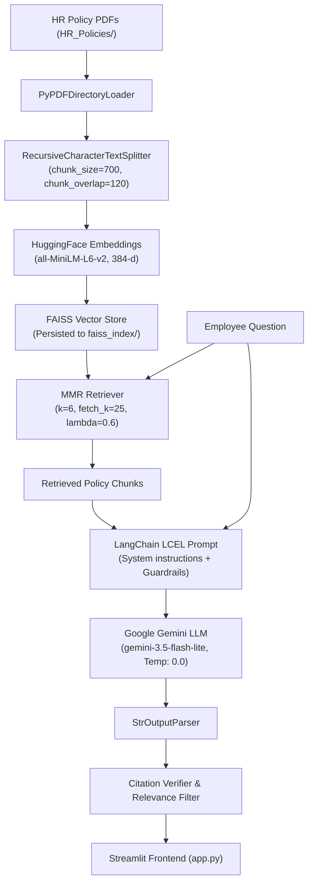

# Zyro Dynamics — Intelligent HR Help Desk Chatbot

> A production-ready, retrieval-augmented generation (RAG) assistant for internal company HR policies, built with LangChain, FAISS, Hugging Face Embeddings, Google Gemini, and Streamlit.

---

## 📌 Project Overview

**Zyro Dynamics HR Help Desk** is an intelligent conversational AI assistant designed to help employees quickly find, understand, and verify internal company HR policies. It processes official HR PDF documents across diverse topics—including leave entitlements, remote work guidelines, business travel reimbursements, compensation & benefits, and employee conduct—delivering accurate answers backed by **exact document citations and page numbers**.

### Key Capabilities
- **Strict Grounded Answering**: Answers are generated strictly from internal HR policy documents.
- **Reliable Source Citations**: Every policy-grounded answer displays verified PDF filenames, 1-based page numbers, and direct source excerpts.
- **Original PDF Download**: Allows employees to download the exact source document directly from the interface.
- **Robust Out-of-Scope Guardrails**: Safely refuses non-HR queries, external company lookups, and confidential personal data requests.
- **High-Performance Caching**: Employs persistent FAISS vector caching and Streamlit resource caching to eliminate redundant re-indexing.
- **Dual-Platform Configuration**: Seamlessly supports local `.env` development and Streamlit Community Cloud `st.secrets`.
- **Optional LangSmith Observability**: End-to-end tracing of retrieval chunks, prompts, and token usage.

---

## 🏗️ Architecture & Pipeline



### Core Architecture Parameters (Preserved from Notebook)
- **Document Loader**: `PyPDFDirectoryLoader`
- **Text Splitter**: `RecursiveCharacterTextSplitter` (`chunk_size=700`, `chunk_overlap=120`, separators: `["\n\n", "\n", ". ", " ", ""]`)
- **Embedding Model**: `sentence-transformers/all-MiniLM-L6-v2` (384 dimensions)
- **Vector Database**: `FAISS` with local directory persistence
- **Retriever**: Maximum Marginal Relevance (`MMR`) with `k=6`, `fetch_k=25`, `lambda_mult=0.6`
- **LLM**: Google Gemini (`gemini-3.5-flash-lite`, `temperature=0.0`, `max_tokens=800`)
- **Orchestration**: LangChain Expression Language (LCEL)

---

## 📂 Project Structure

```
zyro-hr-chatbot/
│
├── app.py                      # Modern SaaS Streamlit web application
├── rag_pipeline.py             # Modular RAG pipeline (Loading, FAISS, LCEL, Citations)
├── config.py                   # Centralized configuration & safe secret management
├── test_pipeline.py            # Automated test suite for 5 validation scenarios
├── requirements.txt            # Minimal, pinned Python dependencies
├── README.md                   # Complete architectural & deployment documentation
├── .gitignore                  # Git ignore rules for keys, cache, and indexes
├── .env.example                # Example environment file for local setups
│
├── HR_Policies/                # Directory containing company policy PDFs (11 documents)
│   ├── 00_Company_Profile.pdf
│   ├── 01_Employee_Handbook.pdf
│   ├── 02_Leave_Policy.pdf
│   ├── 03_Work_From_Home_Policy.pdf
│   ├── 04_Code_of_Conduct.pdf
│   ├── 05_Performance_Review_Policy.pdf
│   ├── 06_Compensation_and_Benefits_Policy.pdf
│   ├── 07_IT_and_Data_Security_Policy.pdf
│   ├── 08_Prevention_of_Sexual_Harassment_Policy.pdf
│   ├── 09_Onboarding_and_Separation_Policy.pdf
│   └── 10_Travel_and_Expense_Policy.pdf
│
└── .streamlit/
    └── secrets.toml.example    # Example secrets configuration for Streamlit Cloud
```

---

## ⚙️ Installation & Local Setup

### 1. Prerequisites
- Python 3.10 to 3.14
- Google Gemini API Key ([Google AI Studio](https://aistudio.google.com/))

### 2. Clone Repository & Navigate
```bash
git clone <your-repository-url>
cd zyro-hr-chatbot
```

### 3. Create and Activate Virtual Environment
```bash
# On Linux / macOS
python -m venv venv
source venv/bin/activate

# On Windows (PowerShell)
python -m venv venv
.\venv\Scripts\Activate.ps1
```

### 4. Install Dependencies
```bash
pip install -r requirements.txt
```

### 5. Configure Environment Variables
Copy `.env.example` to `.env`:
```bash
cp .env.example .env
```
Open `.env` and set your credentials:
```env
GOOGLE_API_KEY=AIzaSy...your_actual_key_here
LANGCHAIN_TRACING_V2=false
LANGCHAIN_API_KEY=
LANGCHAIN_PROJECT=zyro-rag-chatbot
```

### 6. Run the Validation Test Suite
Before launching the UI, you can run the test suite to verify all 5 core scenarios:
```bash
python test_pipeline.py
```

### 7. Launch the Streamlit App
```bash
streamlit run app.py
```
Open your browser at `http://localhost:8501`.

---

## 🚀 Streamlit Community Cloud Deployment

Follow these steps to deploy the application for free on [Streamlit Community Cloud](https://share.streamlit.io/):

### Step 1: Push Code to GitHub
1. Create a new GitHub repository (e.g., `zyro-hr-chatbot`).
2. Verify that `.gitignore` prevents `.env` and `faiss_index/` from being committed.
3. Commit and push the project code:
   ```bash
   git init
   git add .
   git commit -m "Initial commit: Zyro Dynamics HR Help Desk Chatbot"
   git branch -M main
   git remote add origin https://github.com/<your-username>/zyro-hr-chatbot.git
   git push -u origin main
   ```

> ⚠️ **Document Privacy Notice**:
> If your competition rules or company privacy guidelines forbid publishing the HR policy PDFs to a public GitHub repository:
> - Keep your repository **Private** (Streamlit Cloud supports deploying from private GitHub repositories).
> - Alternatively, configure cloud document storage (e.g., AWS S3, Google Cloud Storage, or secure Google Drive) and download PDFs dynamically at initialization.

### Step 2: Deploy on Streamlit Cloud
1. Log in to [share.streamlit.io](https://share.streamlit.io/).
2. Click **New app**.
3. Select your repository: `<your-username>/zyro-hr-chatbot`.
4. Set branch: `main`.
5. Set main file path: `app.py` (or `zyro-hr-chatbot/app.py` depending on repository root).
6. Click **Advanced settings** (or go to App Settings > Secrets after deployment).

### Step 3: Configure Streamlit Cloud Secrets
In the **Secrets** text area, paste your secrets:
```toml
GOOGLE_API_KEY = "AIzaSy...your_gemini_api_key"

# Optional: LangSmith Tracing
LANGCHAIN_TRACING_V2 = "false"
LANGCHAIN_API_KEY = ""
LANGCHAIN_PROJECT = "zyro-rag-chatbot"
```
7. Click **Deploy!**
Your app will build and go live within 2–3 minutes with a public URL (e.g., `https://zyro-hr-helpdesk.streamlit.app`).

---

## 🧪 Evaluation & Test Scenarios

The RAG pipeline has been validated across five benchmark test cases:

| Scenario | Test Question | Verification Result | Verified Citations |
| :--- | :--- | :--- | :--- |
| **1. Leave Policy** | *"How many annual leaves are employees entitled to?"* | Accurately describes 15 days Earned Leave after 1 year service (240 days worked) accruing at 1.25 days/month. | `02_Leave_Policy.pdf` (Page 2) |
| **2. Travel & Expense** | *"What is the reimbursement process for business travel expenses?"* | Explains submission within 7 working days, manager approval, finance 10-day reimbursement cycle, and RBI foreign exchange rates. | `10_Travel_and_Expense_Policy.pdf` (Pages 2, 3) |
| **3. Work From Home** | *"What is the company's work-from-home policy?"* | Details IT equipment provisions, Rs. 1,000 remote internet reimbursement, availability guidelines, and confidentiality protocols. | `03_Work_From_Home_Policy.pdf` (Pages 1, 2, 3) |
| **4. Out-of-Scope** | *"Who won the last IPL?"* | **Politely Refused** using exact HR refusal message. Zero source citations displayed. | None (Refusal Guardrail) |
| **5. Insufficient Info** | *"What is the procedure for purchasing cryptocurrency on the company credit card?"* | **Politely Refused** without hallucination, stating company policy documents do not contain this information. | None (Refusal Guardrail) |

---

## 🛡️ Out-of-Scope Guardrails & Hallucination Prevention

The system enforces strict boundary controls:
1. **Prompt-Level Refusal Instruction**: The system prompt instructs the LLM to only answer based on provided context.
2. **Standard Refusal Message**: When out-of-scope queries (external companies, financials, sports, weather) or ungrounded questions are asked, the model outputs:
   > *"I do not have access to that information in the Zyro Dynamics HR policy documents. I can only assist with internal company HR policies."*
3. **Citation Cleansing**: On refusal, citation cards are automatically withheld to prevent displaying misleading evidence.
4. **Relevance Filtering**: Document chunks retrieved by MMR are verified against the answer content to guarantee that only genuine supporting policy sections are displayed to the user.

---

## 📄 License & Attribution
Developed for the **Zyro Dynamics HR Help Desk** initiative by NxtWave Academy.  
Built with LangChain, Streamlit, FAISS, and Google Gemini.
